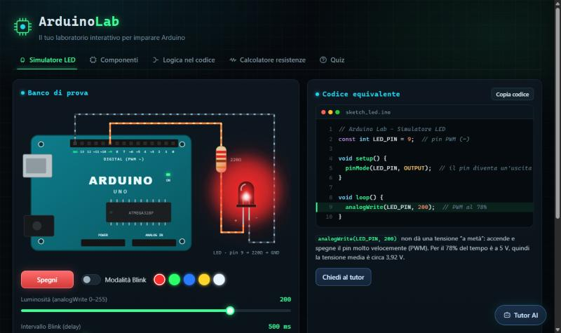
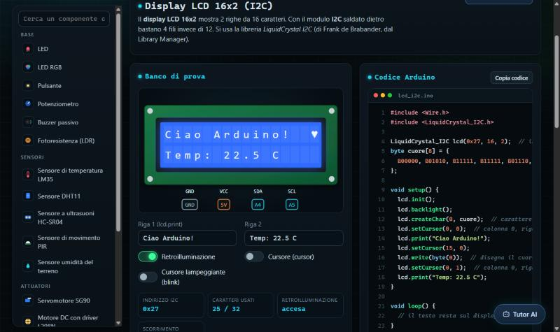
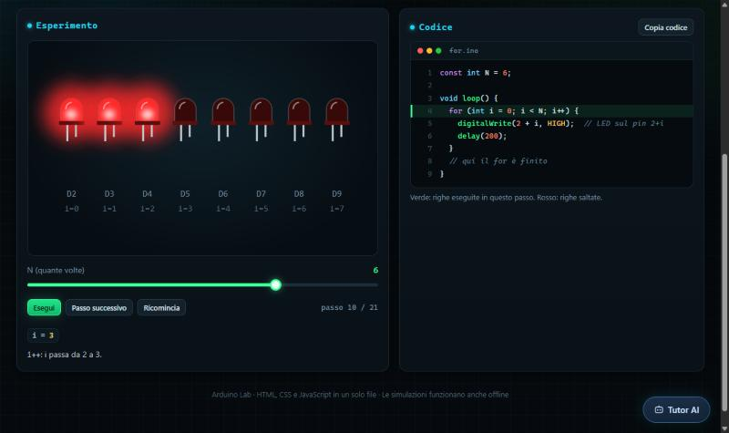
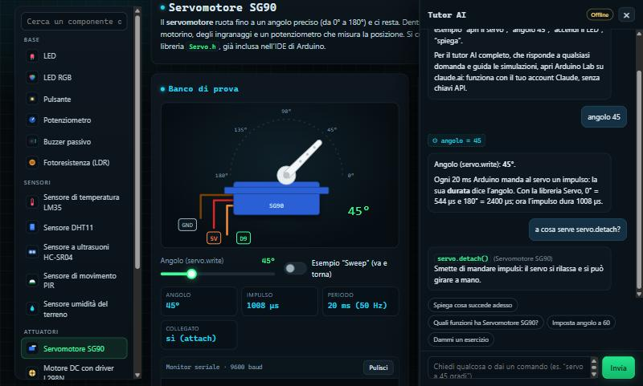

# Arduino Lab

**Il laboratorio interattivo per imparare Arduino, direttamente nel browser.**
Niente da installare, niente scheda da comprare per iniziare: apri la pagina e sperimenta.

**[▶ Prova Arduino Lab](https://pietromolica.github.io/arduino-lab/)**



## Cosa c'è dentro

### Simulatore LED
Accendi un LED, regola la luminosità con `analogWrite` e prova la modalità Blink. Accanto vedi il codice Arduino che si aggiorna in tempo reale, la forma d'onda PWM e la tensione media sul pin.

### 18 componenti con tutte le loro funzioni
Ogni componente ha una simulazione animata, comandi da provare, il codice Arduino pronto da copiare, le misure, il monitor seriale, lo schema dei collegamenti e l'elenco delle sue funzioni (con il pulsante **Prova**).

| Categoria | Componenti |
|---|---|
| Base | LED, LED RGB, pulsante, potenziometro, buzzer (si sente davvero), fotoresistenza |
| Sensori | LM35, DHT11, ultrasuoni HC-SR04, PIR, umidità del terreno |
| Attuatori | servomotore, motore DC con L298N, relè, motore passo-passo |
| Display e moduli | display a 7 segmenti, LCD 16x2 I2C, monitor seriale |



### Logica nel codice, passo per passo
Sette esempi da eseguire un passo alla volta: `if/else`, confronti, `&& || !` con la tabella di verità, `else if`, `switch` (anche cosa succede se dimentichi il `break`), cicli `for` e `while` (compreso un ciclo infinito). Le righe eseguite diventano verdi e vedi le variabili cambiare.



### Calcolatore di resistenze
Tensione di alimentazione, tensione del LED e corrente: ottieni il valore con la legge di Ohm, il valore commerciale della serie E12 e le bande colorate disegnate.

### Quiz
32 domande su basi, componenti e logica: ne escono 10 a caso per partita. Alla fine trovi la spiegazione di ogni errore.

### Tutor
Un assistente sempre a portata di mano che spiega la simulazione che stai guardando e capisce comandi come “apri il servo”, “angolo 45”, “spiega”.
Nella [versione su claude.ai](https://claude.ai/artifact/8vnxeciMufkAFsZF2BdUqi) il tutor è **Claude**: risponde a qualsiasi domanda e comanda le simulazioni da solo, usando il tuo account Claude.



## Come si usa

- **Online:** apri il link qui sopra.
- **Offline:** scarica `index.html` e aprilo con doppio clic. È un unico file HTML, CSS e JavaScript, senza librerie esterne.

Funziona su computer, tablet e telefono.

## Per chi insegna

Arduino Lab è pensato per la scuola: gli studenti possono provare circuiti e codice prima di toccare i componenti veri, anche sui computer del laboratorio dove non si può installare nulla. Ogni simulazione mostra insieme il circuito, il codice e la spiegazione.

## Struttura del progetto

```
index.html                    l'app completa (questo è il file da usare)
sorgenti/src/                 l'app divisa per argomento
  01-head.html                stile grafico
  02-body.html                struttura della pagina
  03-core.js                  schede, simulatore LED, calcolatore
  04-motore.js                motore comune dei componenti
  05-base-sensori.js          componenti Base e Sensori
  06-attuatori-display.js     Attuatori, Display e moduli
  07-logica.js                esempi di logica
  08-quiz.js                  domande del quiz
  09-tutor.js                 tutor (online e offline)
sorgenti/build.ps1            rimette insieme le parti in index.html
sorgenti/versione-claude/     versione da pubblicare su claude.ai
```

Dopo una modifica alle sorgenti, esegui `sorgenti/build.ps1` (clic destro → “Esegui con PowerShell”) per rigenerare `index.html`.

## Contribuire

Idee, nuovi componenti, domande per il quiz o segnalazioni di errori sono benvenuti: apri una *issue* o una *pull request*.

## Licenza

[MIT](LICENSE): puoi usarlo, modificarlo e condividerlo liberamente, anche a scuola.
